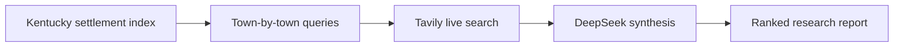

<div align="center">


# Bluegrass Hunter

**A small research agent for finding the businesses the web forgot.**

[](https://www.python.org/)
[](https://tavily.com/)
[](https://www.deepseek.com/)
[](https://github.com/silascroe/bluegrass-hunter)

</div>

> Bluegrass Hunter asks a stubbornly practical question: which local businesses are real, active, and strangely absent from the web?

It is not an email cannon. It does not contact anyone. It builds a case file: search evidence, website status, local fit, contradictions, and a deterministic priority score for a human to inspect.

## The short version

A normal search engine can find a business. It is much worse at understanding a region like “the triangle between Lexington, Maysville, and Morehead” and remembering every small settlement in between.

So we built the missing middle:

1. A Kentucky settlement index, assembled from public USGS and Census data.
2. A town-by-town search pass using Tavily.
3. DeepSeek to read the evidence and turn it into structured findings.
4. Deterministic scoring so the ranking is not pure model vibes.
5. A JSON or Markdown report that a person can actually review.



The model is only one part of the machine. The geography, search discipline, evidence rules, and scoring are what make the output useful.

## What it can answer

- Which businesses appear to operate in a specific Kentucky town?
- Which have no discoverable owned website?
- Which rely on Facebook or directory listings?
- Which have a weak but existing site?
- Which candidates are probably regional companies pretending to be local?
- Which leads deserve a closer human look?

The project deliberately stops before outreach. A missing search result is not proof that a business is closed, and a directory listing is not proof that a business is active.

## The Kentucky map is data, not magic

The checked-in settlement index combines:

- USGS Geographic Names Information System populated places.
- The 2025 U.S. Census Gazetteer place file.
- Deterministic deduplication and place classification.
- Point-in-polygon filtering for named anchor towns.

The current index contains **6,359 settlements**, of which **5,193 are searchable**. Historical places remain in the source data for provenance but are excluded from the search queue.

Regenerate the local index with:

```bash
python scripts/build_place_index.py
```

The region endpoint accepts either three to five anchors or an explicit list of settlements:

```json
{
  "category": "independent service businesses",
  "settlement_names": ["Paris", "Cynthiana", "Flemingsburg", "Mount Sterling"],
  "town_limit": 4,
  "count": 10,
  "verify": true
}
```

Send that JSON to `POST /research-region`. Set `"output_format": "markdown"` for a downloadable Markdown report.

## If you are not technical

The simplest description is this:

We gave a research program a map of Kentucky, taught it to search one small town at a time, connected it to live web search, and gave the resulting evidence to another AI to organize. Then we made the ranking rules explicit so the result could be inspected instead of merely trusted.

That is what an agent is here: not a magic brain, but a sequence of jobs wired together.

## Run it locally

```bash
python -m venv .venv
source .venv/bin/activate
pip install -e .
cp .env.example .env
```

Required environment variables:

```bash
DEEPSEEK_API_KEY=...
TAVILY_API_KEY=...
```

Optional settings include `RESEARCH_TOKEN` and `LEAD_AGENT_MODEL`. Never commit keys or real operational reports.

## API

Readiness:

```bash
curl https://your-service.onrender.com/health
```

Single-location research:

```json
{
  "category": "independent plumbers",
  "location": "Cynthiana, Kentucky",
  "count": 10,
  "output_format": "json"
}
```

Region expansion:

```json
{
  "anchors": ["Lexington", "Maysville", "Morehead"]
}
```

## Where to look around

If you want to understand the project without reading every Python file:

- [Synthetic sample report](reports/examples/sample-report.json)
- [Research rubric](docs/research-rubric.md)
- [Settlement index manifest](data/kentucky_settlements.json)
- [Index-building script](scripts/build_place_index.py)
- [The geography layer](geography.py)
- [The research workflow](agent.py)

## Status

This is a working prototype and a personal open-source artifact, not a finished commercial product. It is intentionally Kentucky-specific for now.

The public repository contains the reproducible architecture and synthetic examples. Real operational reports and contact details stay out of the release.

<div align="center">

*Built as a field experiment in delegation, geography, and the stubborn little businesses that fall between the cracks of ordinary search.*

</div>
